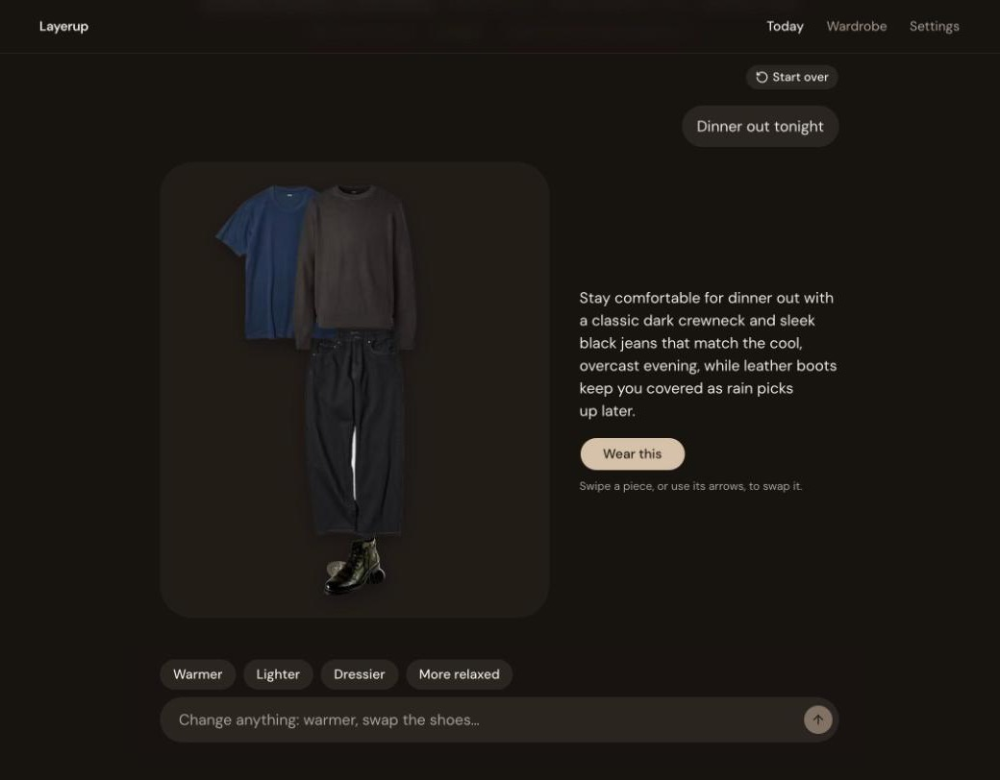
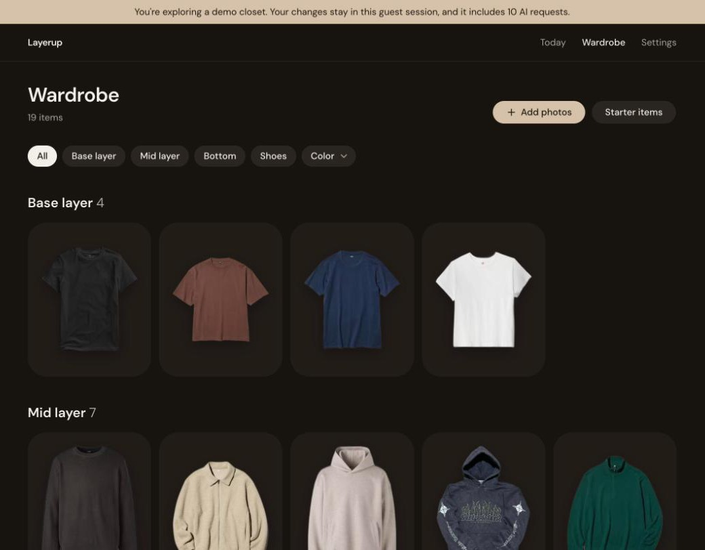

# Layerup

**Dressed for the day in one message.**

A stylist that knows your closet and today's forecast.

**[Try the live demo](https://layerup-woad.vercel.app)**: one click, no sign-up. You get your own copy of a real 19-piece closet and 10 AI requests.

<p>
  
  
</p>

## The problem

Every morning starts the same way: check the weather, open the closet, and stare. The clothes are all there, but turning "52°F, rain by 3pm, office then dinner" into an outfit is a small puzzle you solve half-awake. So you reach for the same three things, get it wrong by noon, and the rest of your wardrobe sits unworn.

## What Layerup does

Layerup turns that puzzle into one message. Tell the stylist what your day looks like, and it dresses you **from the clothes you already own**, layered for the weather you'll actually walk through, from the cold morning to the warm afternoon and the rainy commute home.

- **Your clothes, not a catalog.** Every suggestion comes from your own wardrobe. Nothing to buy.
- **Weather you'll actually feel.** Outfits are built for the whole window you're out, and adjusted for whether you run hot or cold.
- **A stylist you can talk to.** Say "warmer", "dressier" or "more relaxed" and it refines the look instead of starting over.
- **You have the last word.** Swipe any piece on the mannequin to swap it, and the stylist keeps your choice.

## How it works

1. **Build your closet.** Snap your clothes. Layerup removes the background so each piece stands on its own, and picking a type (hoodie, chinos, boots) fills in warmth and weather details for you. AI tagging is one tap away if you want it.
2. **Set your style once.** Pick your vibes, how you run on temperature and how you like things to fit.
3. **Ask the stylist.** Type your plans or tap a starter like "Rainy errands". You get one outfit on a mannequin made from your own pieces, with a short note on why it works.
4. **Refine and wear.** Swipe, chat, then tap **Wear this** to lock it in.

## Try it

Open the demo and tap **Try the demo**. You're signed in as a guest with a private copy of a sample closet, so nothing you change affects anyone else. Ask the stylist something like "rainy errands" or "dinner out tonight", swipe pieces on the mannequin, then browse and edit the wardrobe.

Guests get 10 AI requests. Browsing, swapping and editing don't use any.

## How it's built

| Layer | Choice |
| --- | --- |
| App | Next.js 16 (App Router, server actions, Cache Components), React 19, TypeScript |
| UI | Tailwind CSS v4, Base UI / shadcn components |
| Data and auth | Supabase: Postgres with row-level security on every table, magic-link and anonymous auth, Storage for photos |
| AI | Vercel AI SDK with Gemini Flash Lite, structured output validated with Zod |
| Weather | Open-Meteo forecast and geocoding |
| Background removal | IS-Net running in the browser with `onnxruntime-web`, inside a Web Worker |

```
Browser                                   Server (Next.js)                 Services
───────                                   ────────────────                 ────────
Wardrobe upload ─► Web Worker cutout ───► Supabase Storage (own folder)
Today chat ─────────────────────────────► server action: askStylist ──────► Gemini (structured outfit)
                                            ├─ closet + profile (RLS) ◄──── Supabase Postgres
                                            └─ forecast window ◄─────────── Open-Meteo
```

## Engineering decisions

- **No AI call without a user action.** Opening Today generates nothing. The stylist runs only when you send a message or tap a chip, which keeps the app inside Gemini's free tier.
- **The model picks, the code checks.** The stylist returns a Zod-validated outfit that references item ids from your closet. A closet that can't form an outfit (shoes plus a top and bottom, or a one-piece) gets a clear message before any AI call.
- **Weather as a window, not a number.** Outfits are planned for the hours you're out, using the coldest feels-like temperature, rain timing and wind, shifted by whether you run hot or cold.
- **Chat that respects your edits.** Each refinement ("warmer", "dressier") sends the conversation history. Pieces you swapped by hand are saved first and marked as your choice, so the model keeps them.
- **Resilient to free-tier limits.** When Gemini returns 503 "high demand", the request is resent at once to a fallback model with its own quota instead of waiting through retries. Rate limits and overload show a plain message, never a blank page.
- **Background removal in the browser.** Cutouts run client-side in a Web Worker, so they cost no server time and never freeze the page. The model is cached after the first download. I replaced an AGPL library with an MIT runtime and Apache-2.0 weights so the repo could be MIT-licensed, and compared the cutouts on real photos before switching.
- **A safe public demo.** Each guest is an anonymous Supabase user. A `security definer` function seeds their own closet, and a storage policy lets guests read only the demo photos. A per-guest counter in Postgres caps AI use at 10 requests, and guests can't reset it. A daily cron deletes guests older than 7 days, files first, because storage can't be cleaned up through SQL.
- **Security by default.** Every table has row-level security keyed to the signed-in user, and real sign-ups are invite-only through an allowlist trigger.

## Run it locally

You need a Supabase project and a Gemini API key.

1. Apply the SQL in `supabase/migrations` in order (for example with `supabase db push`). Add your email to the `allowlist` table.
2. For the demo button, enable anonymous sign-ins in Supabase (Authentication → Sign In / Providers) and fill `demo_items` with rows from your own closet; guests copy those.
3. Create `.env.local`:

   ```
   NEXT_PUBLIC_SUPABASE_URL=
   NEXT_PUBLIC_SUPABASE_PUBLISHABLE_KEY=
   GOOGLE_GENERATIVE_AI_API_KEY=
   # Only for the daily guest cleanup (/api/cron/cleanup-guests)
   SUPABASE_SECRET_KEY=
   CRON_SECRET=
   ```

4. Run:

   ```bash
   npm install
   npm run dev
   ```

`npm run lint` and `npm run typecheck` run in CI on every push.

## License

MIT
